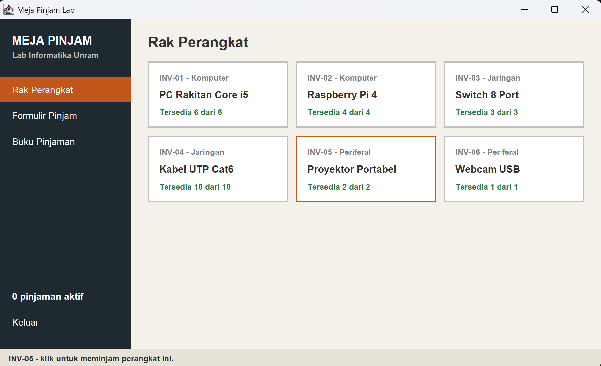
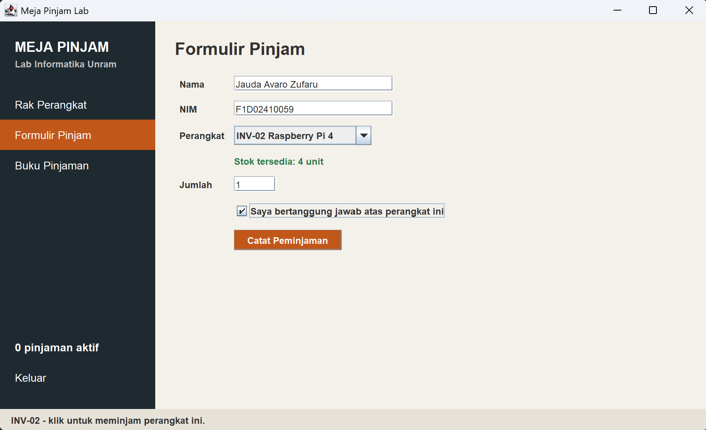
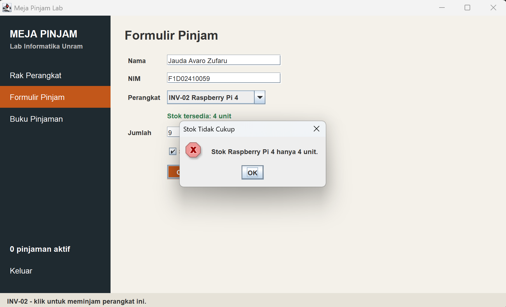
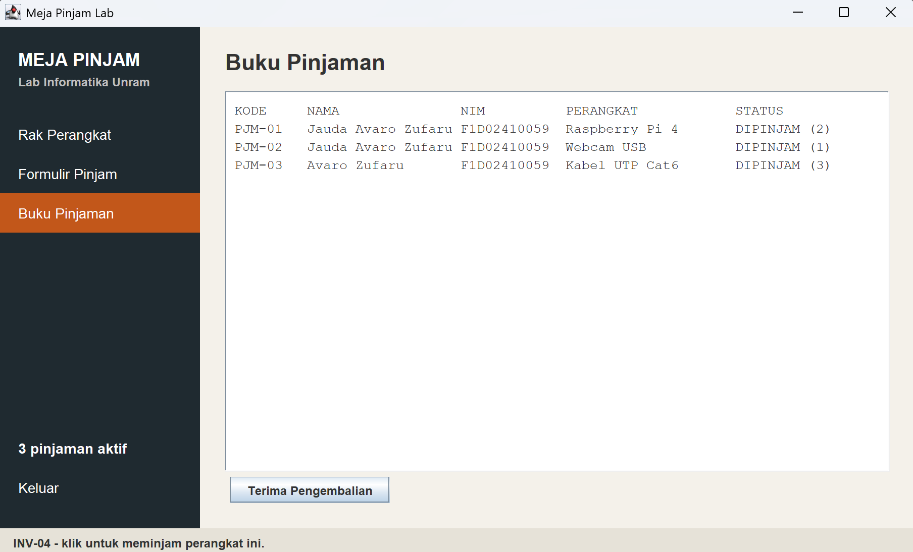
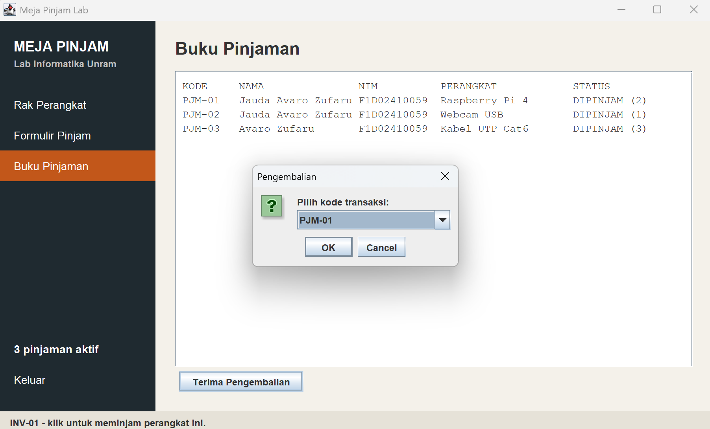
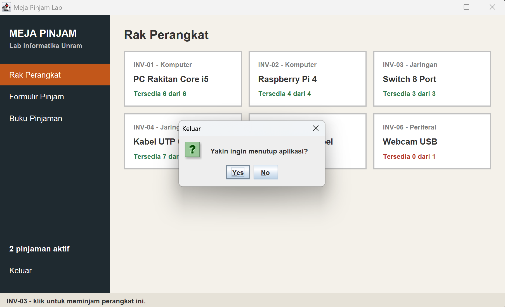

# LATIHAN PEMROGRAMAN BERORIENTASI OBJEK: EKSPLORASI GRAPHICAL USER INTERFACE (GUI) PADA JAVA

### Meja Pinjam Lab, Aplikasi Peminjaman Perangkat Laboratorium dengan Java Swing


Latihan GUI sebelumnya menghasilkan aplikasi untuk mencatat perangkat laboratorium. Eksplorasi ini melanjutkan cerita yang sama ke langkah berikutnya, yaitu meja layanan tempat perangkat itu dipinjam dan dikembalikan. Pengguna melihat stok di rak dalam bentuk kartu, mengklik kartu untuk meminjam, mengisi formulir, lalu transaksinya tercatat di buku pinjaman. Saat perangkat kembali, stok di rak bertambah lagi.

Yang dieksplorasi di sini adalah bagian GUI yang belum dipakai di latihan pertama: navigasi samping dengan `BoxLayout`, perpindahan halaman dengan `CardLayout`, formulir dengan `GridBagLayout`, serta penanganan event lewat *inner class*, baik yang mengimplementasikan interface listener maupun yang mewarisi *adapter class*.

---

## Daftar Isi

1. [Identitas](#1-identitas)
2. [Perintah Tugas dan Pemenuhannya](#2-perintah-tugas-dan-pemenuhannya)
3. [Deskripsi Program](#3-deskripsi-program)
4. [Struktur Proyek](#4-struktur-proyek)
5. [Hierarki Komponen GUI](#5-hierarki-komponen-gui)
6. [Top-Level Container](#6-top-level-container)
7. [Intermediate Container](#7-intermediate-container)
8. [Atomic Component](#8-atomic-component)
9. [Layout Manager](#9-layout-manager)
10. [Event Handling](#10-event-handling)
11. [Cara Menjalankan Program](#11-cara-menjalankan-program)
12. [Screenshot](#12-screenshot)
13. [Catatan dan Batasan](#13-catatan-dan-batasan)

---

## 1. Identitas

| | |
|---|---|
| **Nama** | Jauda Avaro Zufaru |
| **NIM** | F1D02410059 |
| **Kelas** | C |
| **Mata kuliah** | Pemrograman Berorientasi Objek (MBS1302137) |
| **Dosen pengampu** | Royana Afwani, S.T., M.T. |
| **Program studi** | Teknik Informatika, Fakultas Teknik, Universitas Mataram |
| **Tugas** | Latihan/Eksplorasi Materi Graphical User Interface pada Java - 5C |

---

## 2. Perintah Tugas dan Pemenuhannya

Perintah tugas meminta eksplorasi GUI yang memuat Top-level Container Class, Intermediate Container Class, Atomic Component Class, Layout Classes (minimal dua), dan Event Listener, baik dengan *override* method dari Event Listener Interface maupun dari Event Adapter Class.

| Syarat | Dipenuhi oleh |
|---|---|
| Top-level Container Class | `JFrame`, dialog dari `JOptionPane` |
| Intermediate Container Class | `JPanel`, `JScrollPane` |
| Atomic Component Class | `JLabel`, `JButton`, `JTextField`, `JComboBox`, `JCheckBox`, `JTextArea` |
| Layout Classes (minimal 2) | `BorderLayout`, `BoxLayout`, `CardLayout`, `GridLayout`, `GridBagLayout`, `FlowLayout` |
| Event Listener Interface | `ActionListener`, `ItemListener` |
| Event Adapter Class | `MouseAdapter`, `KeyAdapter`, `WindowAdapter` |

---

## 3. Deskripsi Program

Jendela terbagi menjadi tiga bagian. Di kiri ada bilah menu gelap berisi tiga menu halaman, jumlah pinjaman aktif, dan tombol Keluar. Di tengah ada halaman yang berganti sesuai menu yang dipilih, dan menu yang aktif ditandai warna oranye. Di bawah ada bilah status yang menampilkan pesan singkat.

Halaman **Rak Perangkat** menampilkan enam perangkat sebagai kartu. Stok yang masih ada ditulis hijau, stok habis ditulis merah. Saat kursor berada di atas kartu, bingkainya berubah oranye, dan klik pada kartu langsung membuka formulir dengan perangkat tersebut terpilih.

Halaman **Formulir Pinjam** berisi nama, NIM, pilihan perangkat beserta stoknya, jumlah, dan pernyataan tanggung jawab. Tombol **Catat Peminjaman** baru aktif setelah pernyataan dicentang. Kolom jumlah hanya bisa diisi angka.

Halaman **Buku Pinjaman** menampilkan semua transaksi. Tombol **Terima Pengembalian** membuka dialog untuk memilih transaksi yang dikembalikan, lalu stok perangkatnya bertambah lagi di rak.

---

## 4. Struktur Proyek

```text
Latihan Eksplorasi Graphical User Interfaces (GUI) pada Java/
├── src/
│   ├── Main.java              # titik masuk program
│   ├── MejaPinjamFrame.java   # seluruh tampilan dan event handler
│   ├── Perangkat.java         # data satu perangkat dan stoknya
│   └── Peminjaman.java        # data satu transaksi peminjaman
├── bin/                       # hasil kompilasi
├── screenshots/
└── README.md
```

| Kelas | Peran |
|---|---|
| `Main` | Titik masuk program; cukup membuat objek `MejaPinjamFrame`, karena seluruh jendela dibangun di konstruktornya |
| `MejaPinjamFrame` | Membangun jendela, tiga halaman, logika pinjam dan kembali, serta lima *inner class* event handler |
| `Perangkat` | Menyimpan kode, nama, kategori, stok total, dan stok tersedia |
| `Peminjaman` | Menyimpan data peminjam dan rujukan ke objek `Perangkat`; method `tandaiKembali()` mengembalikan stok ke perangkat yang sama |

---

## 5. Hierarki Komponen GUI

```text
JFrame "Meja Pinjam Lab"                                   [BorderLayout]
├── WEST    JPanel sidebar                                 [BoxLayout Y_AXIS]
│           ├── JLabel judul, subjudul
│           ├── JButton btnRak, btnForm, btnBuku
│           ├── Box.createVerticalGlue()
│           ├── JLabel labelRingkasan
│           └── JButton btnKeluar
├── CENTER  JPanel panelHalaman                            [CardLayout]
│           ├── "RAK"   JPanel                             [BorderLayout]
│           │           └── JPanel panelKartu              [GridLayout(0, 3)]
│           │               └── JPanel kartu × 6           [GridLayout(3, 1)] → 3 JLabel
│           ├── "FORM"  JPanel                             [BorderLayout]
│           │           └── JPanel form                    [GridBagLayout]
│           │               ├── JTextField fieldNama, fieldNim, fieldJumlah
│           │               ├── JComboBox comboPerangkat, JLabel labelStok
│           │               ├── JCheckBox cekSetuju
│           │               └── JButton btnCatat
│           └── "BUKU"  JPanel                             [BorderLayout]
│                       ├── JScrollPane → JTextArea areaBuku
│                       └── JPanel                         [FlowLayout] → JButton btnKembali
└── SOUTH   JLabel labelStatus
```

---

## 6. Top-Level Container

**`JFrame`** adalah jendela utama. Tombol silang tidak langsung menutup aplikasi karena diberi `DO_NOTHING_ON_CLOSE`; penutupan diserahkan ke `TutupHandler` (sebuah `WindowAdapter`) yang meminta konfirmasi terlebih dahulu.

```java
frame = new JFrame("Meja Pinjam Lab");
frame.setDefaultCloseOperation(JFrame.DO_NOTHING_ON_CLOSE);
frame.addWindowListener(new TutupHandler());
frame.setLayout(new BorderLayout());
```

**Dialog `JOptionPane`** di baliknya juga membuat `JDialog` modal. Program memakai tiga jenisnya:

| Method | Dipakai untuk |
|---|---|
| `showMessageDialog` | Peringatan data belum lengkap (`WARNING_MESSAGE`), stok tidak cukup (`ERROR_MESSAGE`), dan pemberitahuan berhasil dicatat |
| `showInputDialog` | Memilih kode transaksi yang dikembalikan dari daftar pilihan |
| `showConfirmDialog` | Konfirmasi sebelum keluar (`YES_NO_OPTION`) |

---

## 7. Intermediate Container

| Komponen | Contoh | Fungsi |
|---|---|---|
| `JPanel` | sidebar, `panelHalaman`, `panelKartu`, setiap kartu, `form` | Mengelompokkan komponen supaya setiap kelompok bisa memakai layout sendiri. Setiap kartu perangkat juga sebuah `JPanel` yang bisa menerima event mouse |
| `JScrollPane` | pembungkus `areaBuku` | Memunculkan scroll bar ketika daftar transaksi lebih panjang dari halaman |

Ketiga halaman dibuat lewat method `buatHalaman(judul)`, yang mengembalikan `JPanel` berlatar krem dengan judul di bagian atas. Setiap halaman tinggal menambahkan isinya di bagian tengah.

Kartu perangkat dan formulir tidak langsung ditaruh di tengah halaman, tetapi di bagian `NORTH` sebuah `JPanel` pembungkus. Tanpa pembungkus ini, `BorderLayout` akan merentangkan kartu setinggi halaman sehingga kartu tampak kosong dan terlalu tinggi. Jarak isi kartu dari tepinya diatur dengan `createCompoundBorder`, gabungan garis tepi dan jarak kosong:

```java
private javax.swing.border.Border borderKartu(Color warna) {
    return BorderFactory.createCompoundBorder(
            BorderFactory.createLineBorder(warna, 2),
            BorderFactory.createEmptyBorder(12, 15, 12, 15));
}
```

Method ini dipakai saat kartu dibuat (garis abu-abu) dan saat kursor masuk ke kartu (garis oranye).

---

## 8. Atomic Component

| Komponen | Variabel | Fungsi |
|---|---|---|
| `JButton` | `btnRak`, `btnForm`, `btnBuku`, `btnKeluar` | Menu di sidebar, dibuat lewat `buatTombolMenu()` agar gayanya seragam |
| | `btnCatat`, `btnKembali` | Mencatat peminjaman dan menerima pengembalian |
| `JTextField` | `fieldNama`, `fieldNim`, `fieldJumlah` | Isian formulir |
| `JComboBox<String>` | `comboPerangkat` | Pilihan perangkat yang akan dipinjam |
| `JCheckBox` | `cekSetuju` | Pernyataan tanggung jawab yang mengaktifkan tombol Catat |
| `JTextArea` | `areaBuku` | Daftar transaksi, tidak bisa diedit, font Monospaced agar kolom sejajar |
| `JLabel` | `labelStatus`, `labelStok`, `labelRingkasan`, label pada kartu | Judul dan informasi yang berubah mengikuti data |

---

## 9. Layout Manager

| Layout | Dipakai pada | Alasan |
|---|---|---|
| `BorderLayout` | `JFrame`, setiap halaman | Membagi jendela menjadi sidebar (WEST), halaman (CENTER), dan status (SOUTH) |
| `BoxLayout` | sidebar | Menyusun menu dari atas ke bawah dalam satu kolom |
| `CardLayout` | `panelHalaman` | Menumpuk tiga halaman dan hanya menampilkan satu |
| `GridLayout` | `panelKartu`, setiap kartu | Kartu berukuran sama dalam tiga kolom; isi kartu tiga baris |
| `GridBagLayout` | `form` | Label di kolom kiri dan isian di kolom kanan dengan lebar yang berbeda-beda |
| `FlowLayout` | panel tombol di halaman Buku | Tombol mengikuti ukuran alaminya, rata kiri |

**`CardLayout`.** Setiap halaman didaftarkan dengan nama, lalu tombol menu memanggil `show()` dengan nama tersebut:

```java
cardLayout = new CardLayout();
panelHalaman = new JPanel(cardLayout);
panelHalaman.add(buatHalamanRak(), "RAK");
panelHalaman.add(buatHalamanForm(), "FORM");
panelHalaman.add(buatHalamanBuku(), "BUKU");

cardLayout.show(panelHalaman, nama);   // di dalam bukaHalaman()
```

**`BoxLayout`.** `Box.createVerticalGlue()` mengisi ruang kosong yang tersisa, sehingga ringkasan dan tombol Keluar selalu berada di dasar sidebar:

```java
sidebar.setLayout(new BoxLayout(sidebar, BoxLayout.Y_AXIS));
sidebar.add(btnBuku);
sidebar.add(Box.createVerticalGlue());
sidebar.add(labelRingkasan);
sidebar.add(btnKeluar);
```

**`GridBagLayout`.** Satu baris formulir ditambahkan lewat method `tambahBaris()`. Kolom 0 berisi label, kolom 1 berisi komponennya:

```java
private void tambahBaris(JPanel form, GridBagConstraints gbc, int baris, String teks, JComponent komponen) {
    gbc.gridy = baris;
    gbc.gridx = 0;
    gbc.weightx = 0;
    form.add(new JLabel(teks), gbc);
    gbc.gridx = 1;
    gbc.weightx = 1;
    form.add(komponen, gbc);
}
```

Karena lebar setiap isian mengikuti ukuran aslinya, kolom jumlah tampil pendek sementara nama dan NIM tampil panjang. Hal ini tidak bisa dicapai dengan `GridLayout` yang membuat semua sel sama besar.

**`GridLayout(0, 3)`.** Angka 0 berarti jumlah baris mengikuti banyaknya kartu. Setiap kali data berubah, kartu dibuat ulang:

```java
panelKartu.removeAll();
for (Perangkat p : daftarPerangkat) {
    panelKartu.add(buatKartu(p));
}
panelKartu.revalidate();
panelKartu.repaint();
```

---

## 10. Event Handling

Semua event ditangani oleh *inner class* di dalam `MejaPinjamFrame`, mengikuti contoh `ButtonHandler` dan `TestAdapter` pada materi. Inner class dapat langsung memakai atribut milik kelas luarnya.

| Handler | Jenis | Method di-*override* | Komponen |
|---|---|---|---|
| `TombolHandler` | implements `ActionListener` | `actionPerformed` | 6 tombol |
| `PilihanHandler` | implements `ItemListener` | `itemStateChanged` | `comboPerangkat`, `cekSetuju` |
| `KartuHandler` | extends `MouseAdapter` | `mouseEntered`, `mouseExited`, `mouseClicked` | setiap kartu |
| `AngkaHandler` | extends `KeyAdapter` | `keyTyped` | `fieldJumlah` |
| `TutupHandler` | extends `WindowAdapter` | `windowClosing` | `frame` |

### 10.1 Override dari Event Listener Interface

`ActionListener` hanya punya satu method, jadi langsung diimplementasikan. Satu objek `TombolHandler` melayani enam tombol, dan `getSource()` menentukan tombol mana yang ditekan:

```java
private class TombolHandler implements ActionListener {
    @Override
    public void actionPerformed(ActionEvent e) {
        Object sumber = e.getSource();
        if (sumber == btnRak) {
            bukaHalaman("RAK");
        } else if (sumber == btnCatat) {
            catatPeminjaman();
        } else if (sumber == btnKembali) {
            terimaPengembalian();
        }
        // ... tombol lainnya
    }
}
```

`ItemListener` menangani dua hal. Check box mengaktifkan atau menonaktifkan tombol Catat, sedangkan combo box memperbarui label stok. Combo box mengirim event `DESELECTED` untuk pilihan lama dan `SELECTED` untuk pilihan baru, jadi hanya `SELECTED` yang ditanggapi:

```java
private class PilihanHandler implements ItemListener {
    @Override
    public void itemStateChanged(ItemEvent e) {
        if (e.getSource() == cekSetuju) {
            btnCatat.setEnabled(cekSetuju.isSelected());
        } else if (e.getStateChange() == ItemEvent.SELECTED) {
            tampilkanStok();
        }
    }
}
```

### 10.2 Override dari Event Adapter Class

Adapter class sudah mengimplementasikan semua method suatu interface listener dengan isi kosong, sehingga kita cukup menulis method yang dibutuhkan saja.

**`MouseAdapter`.** `MouseListener` punya lima method, tetapi kartu hanya butuh tiga: menyorot kartu saat kursor masuk, mengembalikannya saat kursor keluar, dan membuka formulir saat diklik. Kartu dikenali dari nama komponen yang diisi kode perangkat (`kartu.setName(p.getKode())`).

```java
private class KartuHandler extends MouseAdapter {
    @Override
    public void mouseEntered(MouseEvent e) {
        JPanel kartu = (JPanel) e.getSource();
        kartu.setBorder(borderKartu(AKSEN));
        labelStatus.setText(kartu.getName() + " - klik untuk meminjam perangkat ini.");
    }

    @Override
    public void mouseExited(MouseEvent e) { ... }

    @Override
    public void mouseClicked(MouseEvent e) { ... pilih perangkat di combo box, buka halaman FORM ... }
}
```

**`KeyAdapter`.** Dari tiga method `KeyListener`, hanya `keyTyped` yang dipakai. Karakter selain angka dibuang dengan `consume()` sebelum masuk ke kolom jumlah:

```java
private class AngkaHandler extends KeyAdapter {
    @Override
    public void keyTyped(KeyEvent e) {
        if (!Character.isDigit(e.getKeyChar())) {
            e.consume();
        }
    }
}
```

**`WindowAdapter`.** `WindowListener` punya tujuh method, padahal yang dibutuhkan hanya `windowClosing`. Tanpa adapter, enam method lainnya harus ditulis kosong:

```java
private class TutupHandler extends WindowAdapter {
    @Override
    public void windowClosing(WindowEvent e) {
        keluar();
    }
}
```

---

## 11. Cara Menjalankan Program

Kebutuhan: JDK 8 atau lebih baru, tanpa library tambahan.

**Melalui terminal**, dari dalam folder proyek:

```bash
javac -d bin src/*.java
java -cp bin Main
```

Pada Command Prompt Windows, gunakan `src\*.java` jika pola `src/*.java` tidak dikenali.

**Melalui Visual Studio Code**, buka `src/Main.java` lalu klik **Run** di atas method `main`.

---

## 12. Screenshot

### 1. Halaman Rak Perangkat
Kursor berada di atas salah satu kartu sehingga bingkainya oranye dan bilah status menampilkan petunjuk (`MouseAdapter`).



### 2. Formulir Pinjam
Formulir `GridBagLayout` terisi, label stok mengikuti perangkat yang dipilih, dan tombol Catat aktif setelah check box dicentang (`ItemListener`).



### 3. Validasi Stok
Dialog `ERROR_MESSAGE` muncul karena jumlah yang diminta melebihi stok.



### 4. Buku Pinjaman
Daftar transaksi setelah beberapa peminjaman dicatat; jumlah pinjaman aktif di sidebar ikut berubah.



### 5. Pengembalian
`showInputDialog` menampilkan daftar kode transaksi yang belum dikembalikan.



### 6. Konfirmasi Keluar
Tombol silang jendela dicegat oleh `WindowAdapter` sehingga muncul konfirmasi terlebih dahulu.



---

## 13. Catatan dan Batasan

Program ini sengaja dibatasi pada materi GUI dan event handling. Tidak ada pemakaian `Thread`, `Runnable`, `SwingUtilities.invokeLater`, `ExecutorService`, maupun ekspresi lambda, karena materi Thread baru dibahas pada pertemuan berikutnya. Method `main` cukup membuat objek `MejaPinjamFrame`, dan semua event ditangani oleh inner class biasa.

Data hanya tersimpan selama aplikasi berjalan dan akan hilang ketika aplikasi ditutup. Daftar perangkat ditulis langsung di konstruktor `MejaPinjamFrame`, sehingga penambahan perangkat baru masih dilakukan lewat kode. Satu transaksi hanya untuk satu jenis perangkat, dan validasi NIM sebatas memastikan kolomnya tidak kosong.
